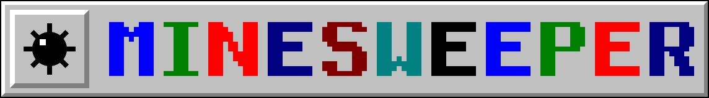

# Minesweeper



A minesweeper game in the classic desktop style, written in Rust with [macroquad](https://macroquad.rs). The board, counters and face are all drawn in code; the only image files are the logo and app icon.

```sh
cargo run --release
cargo test          # game-rule tests
```

## Modes

| Mode         | Size    | Mines |
|--------------|---------|-------|
| Beginner     | 9 × 9   | 10    |
| Intermediate | 16 × 16 | 40    |
| Expert       | 30 × 16 | 99    |
| Custom       | 9–30 × 9–24 | 10 – (w−1)(h−1) |

## Controls

| Input | Action |
|---|---|
| Left click | Reveal (the first click is always safe and opens an area) |
| Right click or Shift+click | Flag → `?` → blank (turn `?` off with **Marks**). Shift+click is easier on a trackpad, and it never reveals a cell |
| Both buttons, middle click, or left click on a number | Chord: reveal neighbours once the right number of flags are placed |
| Smiley / F2 / N | New game |
| 1 / 2 / 3 / 4 (or C) | Beginner / Intermediate / Expert / Custom… |
| M | Toggle `?` marks |
| L | Leaderboard (←/→ or 1/2/3 switch difficulty) |
| Q | Quit |

In the Custom dialog, hold **Shift** to step by 10. Holding a +/− button auto-repeats.

## Leaderboard

Every win on Beginner, Intermediate or Expert is recorded; **Game → Leaderboard...** (or **L**) shows the ten fastest for each. When a game ends, a summary pops up with your time and, for a ranked win, your place among all your wins on that difficulty and its percentile (the share of your other wins it beat). In the summary, Enter starts a new game, Esc closes it and L opens the leaderboard. Custom games and losses aren't ranked.

Times are kept in `~/.local/share/minesweeper/leaderboard.tsv` (`$XDG_DATA_HOME` if set) on Linux and `~/Library/Application Support/Minesweeper/leaderboard.tsv` on macOS.

## Layout

- `src/game.rs`: rules (mine placement, flood fill, chording, win/loss) and their unit tests
- `src/draw.rs`: drawing helpers (bevels, pixel-art digits, LED counters, face, mines, flags)
- `src/scores.rs`: the leaderboard file, ranking and percentiles, and their tests
- `src/main.rs`: window, menu, Custom/Leaderboard/summary dialogs, input handling
- `assets/`: logo and icon. The SVGs are the sources; the PNGs are rendered from them, and `icon-16/32/64.png` are built into the binary as the window and Dock icon
